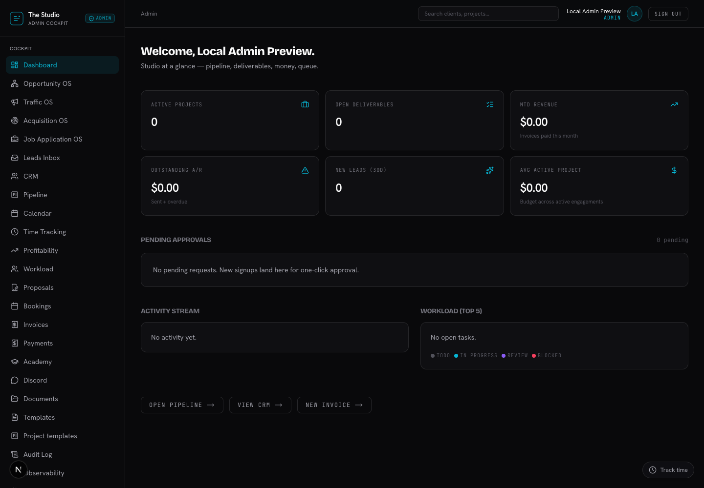

# Studio consolidation — November 8, 2026

The owner has one dashboard (`/admin`) and one navigation definition
(`components/admin/nav-items.ts`). The previous owner dashboard preview bypass
and "Switch to portal" control are removed. Owner desktop sidebar, mobile menu,
client-detail sidebar, and portal command shortcuts use the same navigation.
Actual clients retain their client dashboard and permissions.

## Owner routes

Only authenticated profile-role admins receive these exact-list redirects:

| Previous route | Canonical owner route |
| --- | --- |
| `/portal`, `/portal/home` | `/admin` |
| `/portal/projects`, `/portal/engagements` | `/admin/pipeline` |
| `/portal/calendar` | `/admin/calendar` |
| `/portal/invoices` | `/admin/invoices` |
| `/portal/documents` | `/admin/documents` |
| `/portal/proposals` | `/admin/proposals` |

Filters such as `q` survive redirect. Obsolete `view` and `org` selectors are
removed on these global owner lists. Detail URLs and signed/tokenized proposal
links remain intact; owners see their canonical sidebar on those pages.
`/portal/settings` remains available as Account & security, including the existing
MFA enrollment route. Roles, MFA, idle-session policy, financial records, and
client data are preserved. Refresh cookies survive canonical redirects through
the existing redirect helper.

The mobile menu renders through a React portal so the header's backdrop filter
cannot clip its fixed overlay. It closes on Escape, route changes, backdrop
click, and transition to the desktop breakpoint. Focus returns on close; its
scroll lock and focus trap are cleaned up. `/admin` active state is exact.
Navigation labels pass the scoped contrast audit. Desktop nav scrolls so every
owner action remains reachable on short screens.

## Verification

- Focused tests: **18 passed, 0 failed**. They execute the actual page,
  session/proxy handler, and rendered navigation components with isolated mocks.
- Browser: Chrome, 1440×1000 desktop and 390×844 mobile, reduced motion. Verified
  one owner Dashboard link, full-height mobile menu, focus/Escape restoration,
  and release of the modal/scroll lock on desktop resize.
- axe: **zero violations in the scoped desktop and mobile navigation**. This is
  not a claim that the entire pre-existing dashboard passes accessibility audit.
- Scoped ESLint and commit-time TypeScript/staged-secret checks: passed.
- Independent reviewer: no remaining concrete findings after corrections.
- Broader suite: **314 passed, 16 failed**, matching an untouched `abc28ec6`
  baseline with the same local dependencies. Failure-name sets match exactly;
  no additional broad-suite failures remain.
- Sage Design OS harness: passed.
- Final build status and audit totals are recorded in the adjacent receipt.

Browser proof used the existing development-only admin preview and a read-only
fake database on loopback. No live account, database, payment, or email action
was exercised. The fake server and local development server were stopped.



[Mobile menu proof](proof/studio-consolidation-20261108/mobile.png) ·
[Browser check details](proof/studio-consolidation-20261108/browser-report.json)

Commands:

```bash
node --test tests/unit/studio-entry.test.mjs tests/unit/studio-consolidation.test.mjs
node scripts/qa/prove-studio-consolidation.mjs # requires the documented isolated local preview
npm run test:unit
npm run build
```

The isolated browser command expects `http://localhost:3147/admin`. Start a
read-only fake PostgREST server on `127.0.0.1:3150` returning `[]` for GET/HEAD
and 405 for other methods. Start the app with dummy local-only Supabase values:

```bash
LOCAL_ADMIN_BYPASS=job-os-preview \
NEXT_PUBLIC_SUPABASE_URL=http://127.0.0.1:3150 \
NEXT_PUBLIC_SUPABASE_ANON_KEY=local-proof-placeholder \
SUPABASE_SERVICE_ROLE_KEY=local-proof-placeholder \
npx next dev -p 3147
```

Do not load production credentials or reuse this preview flag for publication.
The existing bypass is already disabled by production/Vercel checks.

## Release limitations and boundary

The baseline clean installation failed because the lockfile omitted packages
already declared in the manifest and three runtime imports lacked direct
dependency declarations. This release declares those already-locked runtime
packages (`@aws-sdk/client-dynamodb` 3.1042.0 and the two OpenTelemetry exporters
at 0.219.0) and synchronizes the missing lock entries. **No existing locked
package version changed.** A full clean `npm ci` passed in an isolated directory,
without `--legacy-peer-deps` or `--ignore-scripts`. Final verification uses that
clean installation and the repository's locked Next.js 16.2.9.

`npm run test:unit` now runs `test:studio` first, so the 18 consolidation tests
are part of the standard gate. The same 16 unrelated baseline failures remain
and are explicitly reported. Dependency audit findings remain unchanged:
52 total (4 critical, 29 high, 15 moderate, 4 low). This consolidation does not
claim to remediate the repository's pre-existing security debt.

No credentials, database schema, or runtime configuration changed. Live account,
client data, and financial record deletion is outside this patch.

Read-only inspection confirms `https://www.sageideas.dev` points to the existing
`qa-portfolio` production project. The local branch is
`fix/studio-admin-entry-20261108`; no push or deployment has been performed.
Publication requires the owner's explicit approval under the supplied
AGENTS.md External Action Boundaries.

Test accounts and the unverified Jason/Neeraj records were preserved. No live
record deletion list is approved by this UI consolidation. Test-email isolation
still needs separate staging database/email configuration; the earlier patch
blocks the main E2E config from targeting the named production domains but does
not isolate every local/preview script automatically.
